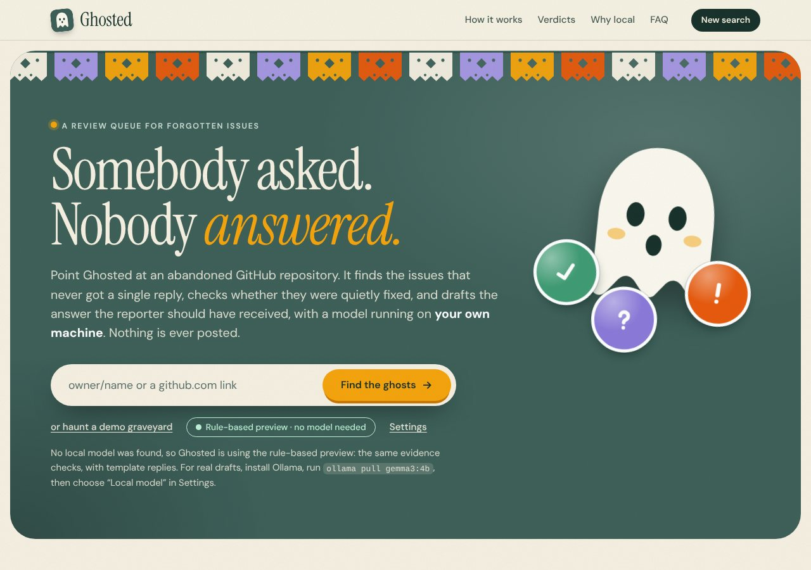
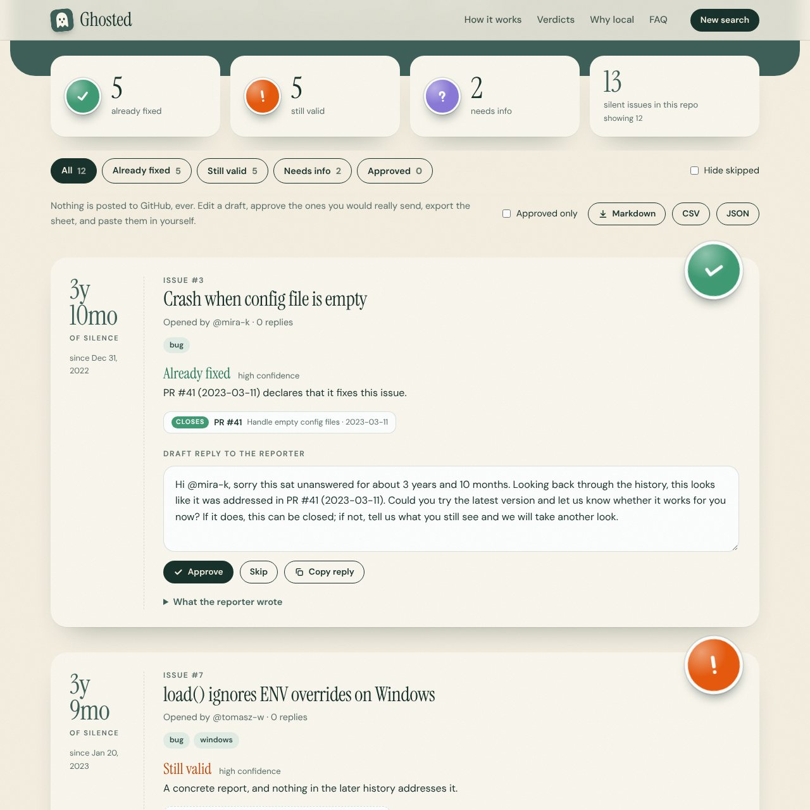
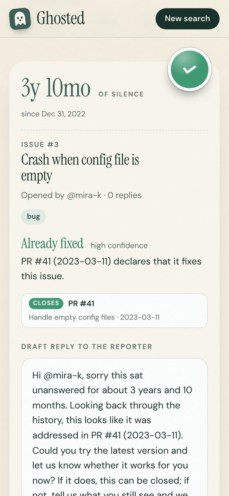

# Ghosted

**Late replies for the issues nobody answered.**

Point Ghosted at an abandoned GitHub repository. It finds the open issues that never received a single comment, checks whether the repository's later history quietly fixed them, and drafts the reply the reporter should have gotten. A model running on **your own machine** does the reading. You review every draft. **Nothing is ever posted.**



- **A review queue, not a bot.** Ghosted only makes read-only `GET` requests to GitHub. There is no code path that comments, labels, closes or opens anything. You edit, approve, copy and post by hand.
- **Local and free to run.** A sweep of a neglected repository is thousands of model calls. On open weights (Ollama, or any OpenAI-compatible server) that costs electricity, not API credits.
- **Evidence over vibes.** "Already fixed" has to be backed by a merged pull request, commit or release note. Drafts can't contain an issue number, version or link that Ghosted can't trace back to the repository's own history.
- **Nothing to install.** Python 3.8+ standard library, one SQLite file, vanilla JavaScript. Fonts are bundled. No CDN, no telemetry, no build step.

## Quick start

From the repository root:

```bash
cd ghosted
python run.py
```

It opens http://localhost:8765. Click **"or haunt a demo graveyard"** to see the whole flow on a made-up repository (`ghost-town/forgotten-lib`). The demo needs no network and no model.

For real drafts, install [Ollama](https://ollama.com) and pull a small model:

```bash
ollama pull gemma3:4b
```

Then paste any `owner/name` or `github.com` link into the box. Ghosted lists whatever Ollama has pulled (Gemma first) and picks one for you.

| Engine | What it is |
| --- | --- |
| **Local model (Ollama)** | Default. Uses Ollama's native `/api/chat` with a JSON schema, and falls back to plain JSON mode on older servers. |
| **OpenAI-compatible server** | LM Studio, llama.cpp's server, vLLM and friends. Defaults to `http://localhost:1234/v1`. |
| **Rule-based preview** | No model at all. Runs the same evidence checks and fills in template replies, so you can see the flow offline. First visits without a model start here. |

## What a scan does

1. **Warm up.** Checks that the model server answers and has the model. Fails early, before touching GitHub.
2. **Read the repo.** Fetches the repository's details. Warns if it is archived (GitHub won't take new comments).
3. **Find silent issues.** Lists open issues (oldest first by default), drops pull requests, drops anything with a comment, keeps those silent for at least *N* days (default 30), up to *M* issues (default 20, max 200).
4. **Dig for fixes.** Reads recent merged PRs, commits and releases, and attaches evidence to each issue (below).
5. **Read and draft.** One model call per issue returns a verdict and a reply. Guardrails check it. The card appears in the queue as soon as it is ready.

A scan costs at most about 22 GitHub requests, and unauthenticated GitHub allows 60 an hour. A read-only token (typed in Settings, or `GITHUB_TOKEN` in your environment) raises that to 5,000. A token typed in the page is held in memory for that scan only and is never saved or returned by the API.

### The three verdicts

| Sticker | Meaning | The draft |
| --- | --- | --- |
| **Already fixed** | Something merged after the report addresses it. | Points at that evidence and asks the reporter to confirm on the latest version. |
| **Still valid** | A clear report and nothing since addresses it. | Apologizes for the silence and says what makes it a real problem. |
| **Needs info** | Too thin to act on. | Asks for exactly what is missing: version, steps, expected versus actual. |

### How evidence works

Only changes made **after** the issue was opened count, and pull requests must be merged.

| Strength | What triggers it |
| --- | --- |
| **closes** | `fixes`, `closes` or `resolves` (and their variants) followed by `#N`, `owner/repo#N` or an issue URL, in a PR's title or body or in a commit message. Phrases like "not fixes", "partially" or "towards" right before it are ignored. |
| **mentions** | `#N`, `GH-N`, `owner/repo#N` or an issue URL (same repository only), in a PR, commit or release note. Release notes also count when they list the PR that fixed the issue. |
| **looks similar** | A weak hint: at least two distinctive words shared with the issue title, covering at least half of its words. |

### Guardrails around the model

The model proposes; the code disposes. Small local models invent PR numbers and version numbers, so every answer is checked before a human sees it:

- Closing evidence forces the verdict to **fixed**. A **fixed** verdict with no evidence at all is downgraded to **needs info**. A fix backed only by a similar title is capped at low confidence.
- A reason or reply that mentions an issue number, version or URL that Ghosted can't trace to the issue or its evidence is replaced with a safe template.
- `@mentions` of anyone but the reporter are defused.
- Issue text is fenced as untrusted data in the prompt, and a test checks that a prompt-injection attempt can't smuggle a link into a draft.
- Anything Ghosted corrected is flagged on the card, so the reviewer sees what was changed and why.
- Replies are parsed tolerantly (code fences, `<think>` blocks, extra chatter) with one retry. If the model keeps failing, the scan stops with a clear message and **Resume** picks up where it left off.

## The review queue



Each card shows how long the issue has been silent, the verdict sticker, the evidence found (or the fact that there was none), and an editable draft. You can **Approve**, **Skip**, **Copy reply**, **Regenerate** (model engines only) or reset an edited draft to the model's version. Edits save automatically. Filters, "Hide skipped" and **Export** (Markdown, CSV or JSON, optionally approved-only) sit above the list. Scans are saved, so you can close the tab and come back.



## Configuration

```
python3 run.py [--host 127.0.0.1] [--port 8765] [--db ./data/ghosted.db] [--no-browser] [--verbose]
```

| Setting | Effect |
| --- | --- |
| `GITHUB_TOKEN` or `GH_TOKEN` | Default GitHub token for scans. |
| `OLLAMA_HOST` | Where Ollama lives, if not `localhost:11434`. |
| `GHOSTED_MODEL` | Model to preselect. |
| `--port` | If the port is busy, the next nine are tried. |
| `--host` | Defaults to this computer only. Binding elsewhere prints a warning and turns off the host check. |

## Tests

```bash
cd ghosted
python -m unittest discover -s tests -q
```

## Limits worth knowing

- **Not yet run against live GitHub from the build environment.** The GitHub client follows GitHub's documented REST API and is tested against a faithful fake. Run one real scan on a small repository to finish the check.
- Evidence comes from the latest ~500 closed pull requests, ~500 commits and 30 releases, and from the first 1,000 open items. Ghosted warns when a repository is bigger than that, so older fixes can be missed.
- Only same-repository references count. A fix that lives in another repository is invisible.
- A small model can still misjudge *still valid* versus *needs info*. That is what the review queue is for.
- The rule-based preview is templates, not understanding.

## Layout

```
run.py              start the server
ghosted/            the app (standard library only)
  github.py         read-only GitHub client (pagination, retries, friendly errors)
  evidence.py       closing keywords, mentions, similar titles, release notes
  analyzer.py       prompt, tolerant JSON parsing, guardrails
  llm.py            Ollama and OpenAI-compatible clients
  rules.py          the no-model preview engine
  templates.py      safe reply templates
  pipeline.py       validation and the background scan (cancel and resume)
  store.py          SQLite persistence
  export.py         Markdown, CSV, JSON
  server.py         JSON API and static files
  demo.py           the fictional ghost-town/forgotten-lib repository
web/                index.html, app.css, app.js, bundled fonts
tests/              unit and integration tests with fake servers
docs/screenshots/   the images above
PLAN.md             design and build notes
```


