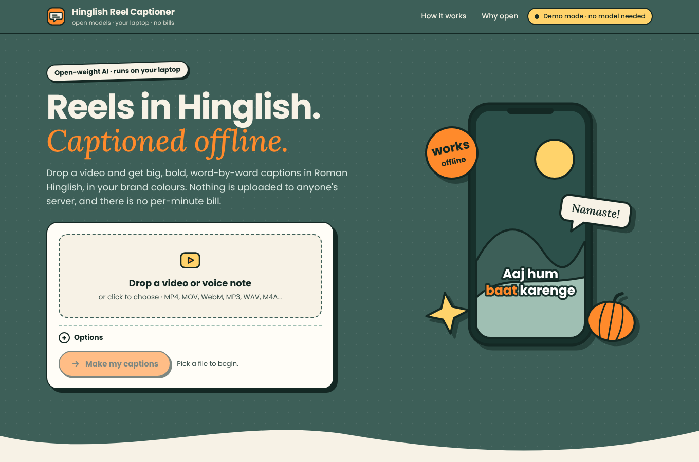
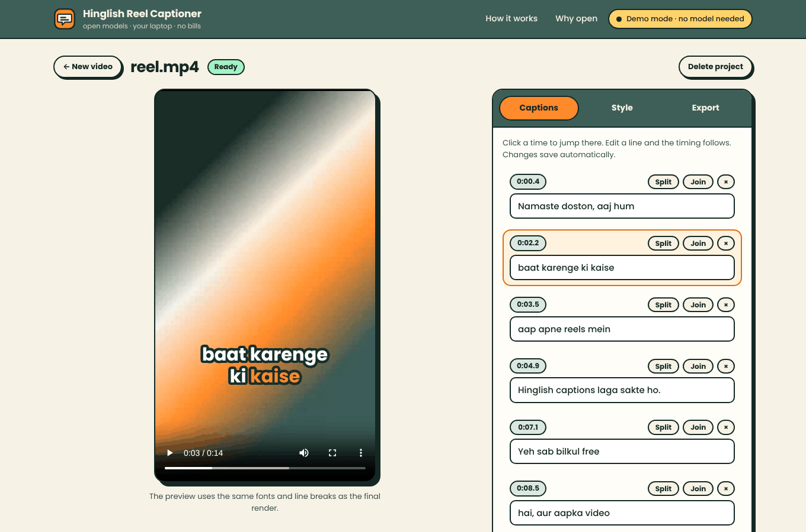
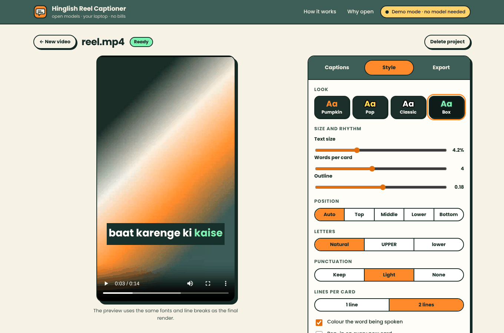
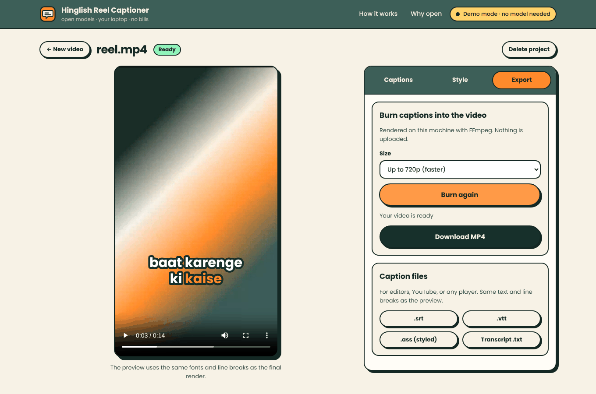
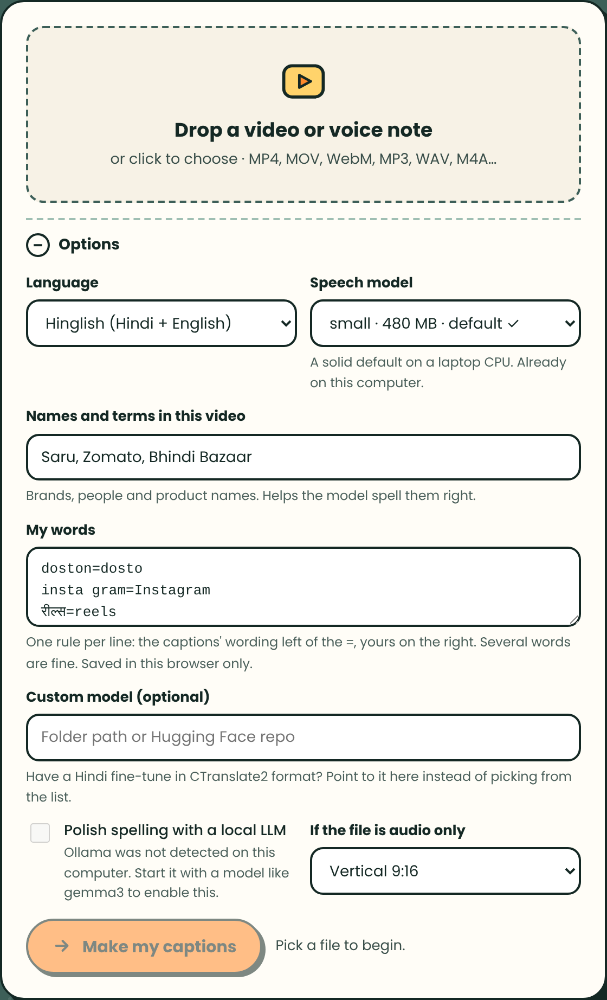

# Hinglish Reel Captioner

[](https://github.com/SaurabhEffect/HacktoberFest-2026/actions/workflows/hinglish-reel-captioner.yml)

**Drop a reel or a voice note. Get big, word-by-word captions in Roman Hinglish, burned in on your own machine.**
Open-weight Whisper does the listening, so there is no per-minute bill and your footage never leaves your computer.



> Screenshots show demo mode: a scripted transcript over a test-pattern video, with no Whisper download.

## Features

- Roman Hinglish captions from local faster-whisper transcription.
- Word-level editing that preserves timing, plus split, join and regroup controls.
- Four styles with live preview, custom colours and saved brand looks.
- MP4 burn-in and `.srt`, `.vtt`, `.ass` and `.txt` exports.
- Audio-only input, with a generated video background.
- User spelling rules and optional spelling cleanup through local Ollama.

## Quick start

You need **Python 3.10 or newer** and **FFmpeg** (with libass, which most builds include).

Install Python 3.10+ and FFmpeg, then run the app from the repository root:

```powershell
cd .\hinglish-reel-captioner
.\run.bat --demo
```

For real transcription instead of the demo, run `.\run.bat` (Windows) or `./run.sh` (macOS/Linux). The first real
transcription downloads the selected Whisper model; the default `small` model is about 480 MB. To use a smaller model:

```powershell
.\run.bat --model tiny
```

The launcher creates a virtual environment, installs dependencies and opens <http://127.0.0.1:8000>. Install FFmpeg
first (`winget install Gyan.FFmpeg` on Windows, `brew install ffmpeg` on macOS, or `sudo apt install ffmpeg` on
Debian/Ubuntu). FFmpeg is required in demo mode too.

## Using the studio

1. **Upload.** Choose a video or voice note. Options include language, Whisper model, recognition hints, spelling
   rules and an audio-only canvas.

2. **Review.** Edit caption text, click a time to seek, or split and join cards. Edits save automatically.



3. **Export.** Choose a style and export a captioned MP4 or subtitle/text file.





## Choosing a speech model

Models are fetched by faster-whisper the first time you use them. Bigger is slower and better at Hinglish.

| Model | Download | Good for |
| --- | --- | --- |
| `tiny` | ~75 MB | quick drafts, rough on Hinglish |
| `base` | ~145 MB | quick drafts |
| `small` | ~480 MB | the default: solid on a laptop CPU |
| `medium` | ~1.5 GB | noticeably better Hindi |
| `large-v3-turbo` | ~1.6 GB | best accuracy per second |
| `large-v3` | ~3 GB | most accurate, slow on CPU |

The default CPU mode uses int8. An NVIDIA GPU can be selected with `HRC_DEVICE=cuda` if its CTranslate2 CUDA
libraries are installed.

## Settings

Options go on the command line or in environment variables. Defaults are chosen for a single person on a laptop.

| Command line | Variable | Default | Meaning |
| --- | --- | --- | --- |
| `--model` | `HRC_MODEL` | `small` | default Whisper model |
| `--port` | `HRC_PORT` | `8000` | port to listen on |
| `--host` | `HRC_HOST` | `127.0.0.1` | interface to bind. Keep it local: there is no login |
| `--data-dir` | `HRC_DATA_DIR` | `./data` | where projects are stored |
| `--demo` | `HRC_ASR_BACKEND=mock` | off | sample transcript, no model needed |
| `--no-browser` | | | do not open a browser tab |
| | `HRC_DEVICE` | `auto` | `cpu`, `cuda`, or `auto` (GPU if one is found) |
| | `HRC_COMPUTE_TYPE` | `auto` | `float16` on GPU and `int8` on CPU, or any CTranslate2 type |
| | `HRC_CPU_THREADS` | `0` | CPU threads for transcription, 0 lets the library decide |
| | `HRC_MAX_UPLOAD_MB` | `2048` | largest accepted upload |
| | `HRC_OLLAMA_URL` | `http://127.0.0.1:11434` | where Ollama listens |
| | `HRC_OLLAMA_MODEL` | automatic | model for the spelling pass (Gemma is preferred) |
| | `HRC_FFMPEG`, `HRC_FFPROBE` | from `PATH` | full paths, if FFmpeg is not on the `PATH` |

## My words

In *My words*, add one `spoken=preferred` spelling rule per line. Rules are case-insensitive; `#` starts a comment.

```
doston=dosto            # captioned "doston", but your audience writes "dosto"
insta gram=Instagram    # several words on the left are fine: they join when they are spoken together
tk=thank you            # and so are several on the right
रील्स=reels             # or the Devanagari that Whisper wrote
```

Rules can match Roman or Devanagari text, can join adjacent spoken words, and are saved in your browser for future
uploads. Brand looks are saved the same way.



## Optional: a spelling pass with a local LLM

If [Ollama](https://ollama.com) is running, tick *Polish spelling with a local LLM* when you upload. The app prefers
Gemma and then Qwen, Llama, Mistral and Phi, for example:

```bash
ollama pull gemma3:4b
```

The local model is restricted to spelling changes: if a response changes the word count or too much text, the
original caption is kept. Timing is unchanged.

## Using it from scripts

Everything the studio does is a small HTTP API, so a batch of reels can be captioned from a shell script:

```bash
curl -F file=@reel.mp4 -F language=hinglish http://127.0.0.1:8000/api/jobs       # {"id": "63d9016a79d340a6b79d"}
curl http://127.0.0.1:8000/api/jobs/63d9016a79d340a6b79d                          # poll until "status": "ready"
curl -OJ http://127.0.0.1:8000/api/jobs/63d9016a79d340a6b79d/download/srt         # saves reel.srt
curl -X POST -H 'Content-Type: application/json' -d '{"max_height": 1080}' \
     http://127.0.0.1:8000/api/jobs/63d9016a79d340a6b79d/render                   # then poll "task.status"
curl -OJ http://127.0.0.1:8000/api/jobs/63d9016a79d340a6b79d/download/mp4         # saves reel-captioned.mp4
```

The form fields of `POST /api/jobs` are `file`, `language`, `model`, `hints`, `user_words`, `polish`, `ollama_model`,
`canvas` and `style` (a JSON object of the style settings). `GET /api/jobs/<id>/cards` returns the captions with their
line breaks, and `POST /api/jobs/<id>/sync` saves edited cards or a new style.

## How it works

1. **FFmpeg** probes the file, extracts 16 kHz mono audio and makes a small preview copy.
2. **faster-whisper** transcribes. Hindi is decoded in Devanagari, with a Hinglish prompt, your names as hotwords,
   voice-activity detection and word timestamps. Whisper writes Hindi in Devanagari and that is the form it handles
   best, so the app lets it, then converts each word.
3. **The romanizer** converts word by word, in this order: your words, English loanwords (kept as English), common
   Hindi words with their usual spellings, then rule-based transliteration with schwa deletion for everything else.
   It is deterministic, so a wrong spelling is fixed once in *My words* and stays fixed.
4. **Cards** are cut at pauses, sentence ends and a word limit, and line widths are measured with the real font.
5. **One layout, two renderers.** Line breaks, font scale and display text are computed once on the server. The
   browser overlay and the ASS file for FFmpeg's libass both use them.

The code is a small FastAPI app in `reelcaptioner/` and a front end of plain HTML, CSS and JavaScript modules in
`reelcaptioner/static/` (no build step, no CDN, fonts bundled).

## Privacy

- Uploads, transcripts and renders stay in the `data/` folder on your computer. *Delete project* removes a folder.
- The only network traffic is the one-time model download (and `pip install`), plus Ollama if you enable the spelling
  pass, which is also on your machine. There are no analytics, no CDN and no web fonts. A test fails if the front end
  ever references an outside address.
- The server listens on `127.0.0.1` only. If you bind it to another address it warns you, because it has no login.

## Limits, honestly

- Transcription accuracy depends on audio quality and model size; review captions before publishing.
- The optional Ollama spelling pass is guarded by tests using a mock server, not a live model.
- Burning captions into MP4 requires FFmpeg with libass. Subtitle and text exports do not.
- The local server has no login; keep it bound to `127.0.0.1`.


